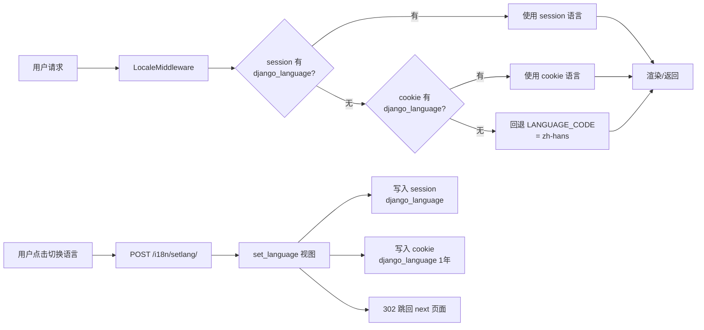

# 多语言支持实施方案（中英双语）

> **工程**：`cloud_eai_server`（云端管理端 Admin，Django 4.2）
> **文档版本**：V1（2026-10-18）
> **目标**：在保持现有中文界面完全不变的前提下，新增英语语言支持，用户可一键切换中/英文，界面文案与后端提示消息全部跟随语言环境。

---

## 1. 背景与目标

### 1.1 背景

当前系统为纯中文界面，所有文案（页面文本、菜单、按钮、后端返回的提示消息、JS 弹窗）均以中文硬编码分布在 Django 模板与视图代码中。为支持海外部署与英文用户使用，需要引入多语言框架。

### 1.2 目标

| # | 目标 | 说明 |
| --- | --- | --- |
| 1 | 中英双语 | 支持简体中文（`zh-hans`）与英语（`en`），默认中文 |
| 2 | 用户可切换 | 顶部导航（已登录）与登录页（未登录）提供语言切换入口 |
| 3 | 偏好可持久 | 语言偏好存 Session + Cookie，刷新/重开浏览器后保持 |
| 4 | 框架可扩展 | 基于 Django 标准 i18n，未来新增语言只需增加翻译文件 |
| 5 | 中文零回归 | 默认语言下界面与现状完全一致（字节级不变的显示效果） |

### 1.3 范围界定（重要）

**本次做：**

- `admin/templates/app/` 下全部 19 个页面模板的静态文案
- 视图（`admin/app/views/*.py`）中传给模板的标题/上下文文案（如 `事件告警`）
- 视图中**面向 Web 页面用户**的提示消息 `msg`（如 `添加成功`、`无权限`，最终展示在 `message.html` 或 JS 弹窗中）
- 语言切换 UI、i18n 基础设施、翻译文件构建流程

**本次不做（已确认）：**

| 不做的内容 | 原因 |
| --- | --- |
| `open/*` 节点对接接口的 `msg`（如 `alarm/openPush`、`open/getIndex` 等被节点/集群平台调用的接口） | 调用方是程序，仅记日志，不做展示 |
| 数据库中的中文业务数据（节点名称、告警对象名、算法名等） | 数据由用户/节点产生，属于运行数据非界面文案 |
| 边缘节点端页面（iframe 嵌入的 `/proxy/node/...`） | 节点端工程自行负责，本次仅云端 |
| 告警图片水印、节点端生成的叠加文字 | 需节点端配合，本次仅云端 |
| `settings.json` 中的产品名 `name`、`logo_url` 等品牌信息 | 品牌名各语言保持一致 |
| 日志输出（`g_logger.*`） | 运维排查统一中文，不翻译 |
| 异常技术原文（`str(e)`） | 技术信息，保持原样透出 |
| 时间/日期/数字格式本地化 | 保持 `TIME_ZONE='Asia/Shanghai'`、`USE_TZ=False` 现状，显示格式不变（刻意决策，避免运维习惯变化） |

### 1.4 翻译范围速查表（开发时判定用）

| 场景 | 是否翻译 | 处理方式 |
| --- | --- | --- |
| 模板静态文案（菜单/表头/按钮/占位符/提示） | ✅ | `` |
| 模板含变量的文案（`欢迎 {{ name }}`） | ✅ | `` |
| 视图传给模板的 `title` 等上下文 | ✅ | `gettext(...)` 请求时求值 |
| Web 页面操作 API 返回并被弹窗/`message.html` 展示的 `msg` | ✅ | `gettext(...)` |
| `open/*` 节点/第三方对接接口 `msg` | ❌ | 保持原样 |
| `g_logger` 日志、`str(e)` 异常原文 | ❌ | 保持原样 |
| 数据库业务数据 | ❌ | 保持原样 |
| `settings.json` 品牌字段 | ❌ | 保持原样 |

> **判定 `msg` 归属的实操方法**：全局搜索该 `msg` 的消费方——若最终出现在浏览器 UI（`message.html`、`layer.alert`、`toastr` 等）则翻译；若仅被节点 HTTP 客户端、日志消费则不翻译。存在同一视图内两类混用的情况，逐条判定。

---

## 2. 现状分析

### 2.1 现有 i18n 相关配置

`admin/framework/settings.py`：

```python
USE_I18N = True          # 已开启，但实际未使用任何翻译机制
USE_L10N = True          # Django 4.2 已弃用（默认即本地化），建议顺手删除
LANGUAGE_CODE = 'zh-hans'
TIME_ZONE = 'Asia/Shanghai'
USE_TZ = False
```

**未配置**：`LocaleMiddleware`、`LANGUAGES`、`LOCALE_PATHS`、`locale/` 目录、语言切换路由。即当前 Django i18n 机制完全未启用，仅为"配置存在、能力未用"状态。

### 2.2 硬编码中文分布摸底

| 位置 | 文件数 | 情况 |
| --- | --- | --- |
| `admin/templates/app/` | 19 个 HTML | 全部含中文。`sidebar.html`（约 153 处命中，**其中绝大多数为 CSS 注释**，实际菜单文案约 20 条）、`index.html`（63 处）、`dashboard.html`（26 处）、`alarm/*`（4 个）、`node/`、`stream/`（2 个）、`control/`（2 个）、`user/`（2 个）、`system/`、`version/`、`top_navigation.html`、`footer.html`、`message.html`、`login.html` |
| `admin/app/views/` | 11 个业务视图 | `msg` 提示消息（`添加成功`/`删除失败`/`无权限`/`未知错误`/`账号已锁定` 等）、render 上下文 title（`事件告警`/`车牌告警` 等）、异常消息 |
| `admin/static/build/js/custom.js` | 1 | 14 处中文命中，**均为注释**，无界面文案 |
| 模板内嵌 `<script>` | 分布于各 HTML | `layer.alert('删除成功')`、`confirm('确定删除？')` 等 JS 弹窗文案，随模板渲染，**可用模板标签直接翻译**（见 4.6） |

**文案总量估算**：全站去重后约 **700 ~ 1000 条**（模板约 500~700 条 + 视图 msg 约 200~300 条）。

### 2.3 影响方案的既有事实

1. **`SessionMiddleware` 重复注册了两次**（`settings.py` MIDDLEWARE 列表），需在本方案中顺带修复，`LocaleMiddleware` 插入位置依赖它。
2. **`CsrfViewMiddleware` 被注释禁用**，全站无 CSRF 校验 —— 语言切换表单（POST）不会被 CSRF 拦截，方案可直接使用 Django 内置 `set_language` 视图。
3. **`login.html`、`message.html`、`dashboard.html` 是独立页面**（不继承 `base_site.html`，自带完整 `<html>`），改造时每个页面需单独 `` 并处理 `<html lang>`。
4. **登录拦截**：`app/middleware.py` 的 `SimpleMiddleware` 未放行 `i18n/` 路径，登录页切换语言会被重定向到 `/login` 死循环，**必须放行**（见 4.3）。
5. 前端为 jQuery + Bootstrap 服务端渲染，无前端框架、无构建链，**模板标签翻译是最自然路径**，无需引入运行时 i18n 库。
6. `BASE_DIR` = `admin/` 目录（`settings.py` 位于 `admin/framework/`），`locale/` 目录应放在 `admin/locale/`。
7. `whitenoise` + `CompressedManifestStaticFilesStorage` 托管静态资源，语言切换不涉及静态文件变更，无影响。

---

## 3. 总体设计

### 3.1 技术选型

**采用 Django 标准 i18n（gettext 体系）**，理由：

- Django 原生内建，`USE_I18N` 已开启，零新增依赖；
- `makemessages` 自动从模板/代码提取文案，避免手工维护键值清单；
- `LocaleMiddleware` + `set_language` 开箱即用地满足"Session + Cookie"存储需求；
- 后续新增语言（如繁中、日语）只需增加 `.po` 翻译文件，代码零改动。

### 3.2 源语言策略（关键决策）

**以中文为源语言（`msgid` 即中文原文），`en` 为翻译语言。**

```
代码/模板中：        _("节点管理")            ← msgid = "节点管理"（中文原文）
admin/locale/en/LC_MESSAGES/django.po：
                     msgid  "节点管理"
                     msgstr "Node Management"
admin/locale/zh_Hans/： 不需要 .po 文件
```

- 默认语言 `zh-hans` 找不到翻译时**自动回退显示 msgid 本身**（即中文原文）→ 中文界面天然零回归，且**无需维护中文 .po**；
- 现有代码改造只需"把中文字符串包一层翻译函数"，**不需要为每条文案发明英文键名**，替换工作机械化、低风险；
- 代价：未来若接入不识中文的翻译团队，需借助工具辅助。当前团队中文为工作语言，此代价可忽略。

> 备选方案"英文作 msgid"被否决：需为约 1000 条文案逐条设计英文键，改造与评审成本翻倍，且极易出现键名与中文语义漂移。

### 3.3 语言协商与存储流程



- **已登录**：语言存 session（服务端），同时 cookie 兜底；
- **未登录（登录页）**：匿名 session 同样可用（Django 为匿名请求创建 session），即使 session 丢失 cookie 仍保住偏好；
- 语言代码：`zh-hans`（Django 中文标准码，与现配置一致）、`en`。

### 3.4 整体架构

```
admin/（BASE_DIR）
├── framework/
│   ├── settings.py          # + LANGUAGES / LOCALE_PATHS / LocaleMiddleware
│   └── urls.py              # + /i18n/ 路由（set_language）
├── app/
│   ├── middleware.py        # SimpleMiddleware 放行 i18n/ 前缀
│   ├── views/
│   │   ├── ViewsBase.py     # 公共 msg 统一出口（可选封装 _() 快捷函数）
│   │   └── *.py             # msg / context title 包 gettext
│   └── ...
├── templates/app/           # 19 个模板： + 
└── locale/                  # ★ 新增
    └── en/
        └── LC_MESSAGES/
            ├── django.po    # 英文翻译（人工维护）
            └── django.mo    # 编译产物（部署必需）
```

---

## 4. 详细设计

### 4.1 `settings.py` 改造

```python
from django.utils.translation import gettext_lazy as _   # 文件顶部新增

# Internationalization
USE_I18N = True
# USE_L10N = True          # ← 删除：Django 4.2 已弃用（默认开启），避免弃用警告
USE_TZ = False

LANGUAGE_CODE = 'zh-hans'   # 默认语言：中文（保持不变）

# ★ 新增：可用语言列表（界面文案用 lazy，切换器里显示各自语言的名字）
LANGUAGES = [
    ('zh-hans', _('简体中文')),
    ('en', _('English')),
]

# ★ 新增：翻译文件搜索路径（BASE_DIR 即 admin/ 目录）
LOCALE_PATHS = [
    os.path.join(BASE_DIR, 'locale'),
]
```

### 4.2 中间件改造（`MIDDLEWARE`）

`LocaleMiddleware` 必须位于 `SessionMiddleware` **之后**（依赖 session）、`CommonMiddleware` **之前**。同时修复 `SessionMiddleware` 重复注册的既有问题：

```python
MIDDLEWARE = [
    'django.middleware.security.SecurityMiddleware',
    'whitenoise.middleware.WhiteNoiseMiddleware',
    'django.contrib.sessions.middleware.SessionMiddleware',
    # 'django.contrib.sessions.middleware.SessionMiddleware',   # ← 删除：原本重复注册了两次
    'django.middleware.locale.LocaleMiddleware',                # ★ 新增：语言协商
    'django.middleware.common.CommonMiddleware',
    # 'django.middleware.csrf.CsrfViewMiddleware',
    'django.contrib.auth.middleware.AuthenticationMiddleware',
    'django.contrib.messages.middleware.MessageMiddleware',
    'django.middleware.clickjacking.XFrameOptionsMiddleware',
    "app.middleware.SimpleMiddleware",
    "app.middleware.ResponseSessionMiddleware",
]
```

> **回退兜底**：`LocaleMiddleware` 支持通过 URL 前缀（`/en/...`）显式指定语言，本方案**不启用** URL 前缀（保持现有 URL 结构不变，避免破坏 `SimpleMiddleware` 的前缀匹配逻辑与节点回调地址）。

### 4.3 路由与登录拦截放行

**`framework/urls.py`** 追加：

```python
from django.urls import path, include

urlpatterns = [
    # ... 现有路由 ...
    path('i18n/', include('django.conf.urls.i18n')),   # ★ 新增：提供 POST /i18n/setlang/
]
```

**`app/middleware.py` 的 `SimpleMiddleware.process_request`** 未登录放行清单中追加 `i18n/`（登录页切语言时该请求无登录态）：

```python
if path.startswith("login") or path.startswith("captcha") \
        or path.startswith("i18n/") \          # ★ 新增：语言切换（登录页也需要）
        or path.startswith("open/") \
        or path.startswith("node/open") \
        ...
```

### 4.4 语言切换 UI 与后端

使用 **Django 内置 `set_language` 视图**（`django.conf.urls.i18n` 已包含）：POST `{language: 'en', next: '/node/index'}` → 写 session + cookie → 302 回 `next`。项目 CSRF 已禁用，普通 POST 表单即可。

**① 顶部导航（`top_navigation.html`，已登录）** —— 在右侧用户菜单旁加语言切换：

```html

<li role="presentation" class="dropdown">
  <a href="javascript:;" class="dropdown-toggle info-number" data-toggle="dropdown">
    <i class="fa fa-globe"></i>
  </a>
  <ul class="dropdown-menu list-inline menu_scrolle" style="min-width:120px">
    
    <form action="" method="post" id="lang-form">
      <input type="hidden" name="next" value="{{ request.get_full_path }}">
    </form>
    <li class="active">
      <a href="javascript:;" onclick="document.getElementById('lang-form').language.value='zh-hans';document.getElementById('lang-form').submit();">
        <input type="hidden" value="">
        简体中文
      </a>
    </li>
    <li class="active">
      <a href="javascript:;" onclick="document.getElementById('lang-form').language.value='en';document.getElementById('lang-form').submit();">
        English
      </a>
    </li>
  </ul>
</li>
```

> 实现时可简化为两个直接提交的 `<form>`（每个语言一个），避免 JS 操作隐藏域；上述写法仅示意交互。语言名刻意不翻译（各语言用自身名字展示，业界惯例）。`context_processors` 已含 `request`，`{{ request.get_full_path }}` 可直接用。

**② 登录页（`login.html`，未登录）** —— 页面右上角放同样的切换控件（精简为两个链接式按钮）。登录页切换只依赖 cookie + 匿名 session，`SimpleMiddleware` 放行 `i18n/` 后可正常工作。

**③ 各语言版本页签高亮当前语言**，切换后整页刷新即为新语言。

### 4.5 模板层改造规范

**通用规则：**

1. 每个模板顶部（`` 之外）加 ``；
2. `<html lang="zh-CN">` / `lang="en"` 改为 `<html lang="{{ LANGUAGE_CODE }}">`（`LANGUAGE_CODE` 由 i18n 上下文自动注入，值如 `zh-hans`/`en`）；
3. 静态文案 → ``；
4. 含变量文案 → ``；
5. **不要**对 `{{ settings.name }}`、`{{ msg }}` 等来自后端/配置的变量再包 `trans`（后端已译或刻意不译）。

**改造示例（`sidebar.html`）：**

```html

...
<a href="/" data-title="">
  <i class="fa fa-home"></i> <span></span>
</a>
...
<li><a href="/alarm/event" data-title=""></a></li>
```

**改造示例（含变量，`top_navigation.html`）：**

```html
欢迎，{{ name }}
```

**改造示例（`message.html` 的确认按钮）：**

```html
<button class="confirm"></button>
{# <title>提示中</title> → <title></title> #}
```

**属性文案**（placeholder / title / data-xxx）同样使用 ``：

```html
<input type="text" placeholder="">
```

### 4.6 JS 文案处理

经摸底，`static/build/js/custom.js` 中的中文**全部是注释**，无界面文案；业务 JS 均内嵌在各 HTML 模板的 `<script>` 中。因此：

- **主方案（覆盖 99% 场景）**：模板内嵌 JS 中的静态文案直接用 ``——JS 代码在模板里，Django 渲染时即完成替换：

  ```html
  <script>
  function delNode(id) {
      layer.confirm("", function(index){
          ...
      });
  }
  </script>
  ```

- **注意引号转义**：JS 字符串内若文案含单/双引号，`` 输出会破坏 JS 语法，需用 `` + `{{ var|escapejs }}`：

  ```html
  
  layer.confirm("{{ MSG_CONFIRM_DEL|escapejs }}", ...)
  ```

- **备选方案（本次不实施）**：若未来出现独立 `.js` 文件中的文案，再启用 Django 的 `JavaScriptCatalog`（`path('jsi18n/', JavaScriptCatalog.as_view(), {'packages': None})`，JS 中用 `gettext('...')`）。
- **动态 msg**（`ajax` 返回的后端 `msg` 弹窗展示）：由后端 `gettext` 翻译（见 4.7），前端不处理。

### 4.7 视图层改造规范

**两条铁律：**

- **请求内求值**（视图函数体内、每次请求执行的代码）：用 `gettext as _`
- **模块级/类级常量、import 期求值**：用 `gettext_lazy as _`（延迟到渲染/访问时才求值，绑定用户语言）

**① 视图函数内 `msg`（用 `gettext`）：**

```python
# admin/app/views/UserView.py
from django.utils.translation import gettext as _

def api_postDel(request):
    msg = _("未知错误")          # 原：msg = "未知错误"
    ...
                        msg = _("删除成功")     # 原："删除成功"
                        msg = _("删除失败")     # 原："删除失败！"
```

**② render 上下文 title（用 `gettext`，在请求时求值）：**

```python
# admin/app/views/AlarmView.py
from django.utils.translation import gettext as _

def page_event(request):
    return render(request, 'app/alarm/list.html', _alarmListContext(request, 0, _("事件告警")))

def page_carplate(request):
    return render(request, 'app/alarm/list.html', _alarmListContext(request, 1, _("车牌告警")))
```

**③ 模块级常量（用 `gettext_lazy`）**——如 `settings.py` 的 `LANGUAGES`、模块顶部定义的常量字符串：

```python
from django.utils.translation import gettext_lazy as _
DEFAULT_TITLE = _("控制面板")
```

**④ 公共出口封装（可选，推荐）**：`ViewsBase.py` 中已有大量被各视图复用的返回结构，可统一封装，减少各视图重复 import：

```python
# admin/app/views/ViewsBase.py 顶部
from django.utils.translation import gettext as _, gettext_lazy as _lz
# 各视图文件沿用：from app.views.ViewsBase import _   （如采用统一出口）
```

> 具体是否统一出口由实施时视视图文件 import 结构决定，两种方式（各自 import / 统一从 ViewsBase import）均可行，不做强制。

**⑤ 明确不改的视图代码**：`OpenView.py` 的 `open/*` 接口 msg、`InnerlView.py`、各视图中的 `g_logger` 调用与 `str(e)` 透传，按 1.4 速查表保持原样。

### 4.8 翻译文件管理与构建流程

**① 工具安装（一次性）：**

```bash
# Debian/Ubuntu（开发机与构建机）
sudo apt-get install gettext
# 验证
msguniq --version && msgfmt --version
```

> Docker 镜像若用于构建翻译，需在 Dockerfile 增加 `RUN apt-get update && apt-get install -y gettext`。运行时**不需要** gettext（只读 `.mo`）。

**② 提取文案（每次代码变更后）：**

```bash
cd admin/
mkdir -p locale
# 忽略第三方静态目录，避免提取 vendors/lib 里的中文
django-admin makemessages -l en \
    --ignore=static/vendors/* \
    --ignore=static/lib/* \
    --ignore=static/build/* \
    --ignore=log/* \
    --ignore=zlmediakit/* \
    --no-obsolete
```

- 只生成 `locale/en/LC_MESSAGES/django.po`（中文为源语言，不需要 zh_Hans 的 po）；
- `--no-obsolete` 自动清理已删除文案的条目；
- 重复执行会**合并增量**，已翻译的 `msgstr` 保留。

**③ 翻译 `django.po`（人工/协作）：**

```po
#: templates/app/sidebar.html:747
msgid "节点管理"
msgstr "Node Management"

#: views/UserView.py:260
msgid "添加成功"
msgstr "Added successfully"
```

**翻译规范：**

- msgid 即中文原文，**禁止改 msgid**（改了代码里也要同步改）；
- 同文异义（如"打开"动词/状态）用上下文标记：代码 `pgettext("action", "打开")`，po 中 `msgctxt "action"`；
- 占位符 `{name}`（blocktrans 生成）必须原样保留；
- 未翻译条目留空 `msgstr ""`，Django 自动回退显示中文（安全兜底，英文环境看到中文总比看到错误好）。

**④ 编译与生效：**

```bash
cd admin/
django-admin compilemessages       # po → mo
# 重启 Django 服务（生产）；dev 模式修改 po 编译后也会自动加载
```

**⑤ 版本管理约定：**

- `locale/en/LC_MESSAGES/django.po` **入库**（翻译资产）；
- `django.mo` **入库**（本项目无 CI 构建环节，随包部署；若后续建 CI 可改为构建时编译并从仓库移除）；
- `.po` 文件头 `charset` 必须为 `UTF-8`。

---

## 5. 分阶段实施计划

> 每阶段完成后可独立提交、独立验收；P0~P1 完成即具备演示能力（框架 + 骨架页面英文）。

### P0：i18n 基础设施（0.5 人天）

| # | 任务 | 文件 |
| --- | --- | --- |
| 1 | `LANGUAGES`/`LOCALE_PATHS` 配置，删 `USE_L10N`，顶部 import `gettext_lazy` | `admin/framework/settings.py` |
| 2 | MIDDLEWARE：删重复 `SessionMiddleware`，插入 `LocaleMiddleware` | `admin/framework/settings.py` |
| 3 | 追加 `/i18n/` 路由 | `admin/framework/urls.py` |
| 4 | `SimpleMiddleware` 放行 `i18n/` 前缀 | `admin/app/middleware.py` |
| 5 | 创建 `admin/locale/` 目录结构 | 新增 |
| 6 | 安装 gettext 并跑通一次空 `makemessages`/`compilemessages` | 环境 |

**验收**：`POST /i18n/setlang/`（language=en）后 302 回原页；`GET /`（任意页）响应头 `Content-Language` 跟随切换；默认匿名访问仍为中文，全站无回归。

### P1：公共组件双语化（1 人天）

| # | 任务 | 文件 |
| --- | --- | --- |
| 1 | 侧边栏菜单/分组标题双语 | `templates/app/sidebar.html` |
| 2 | 顶栏：品牌区、公告、用户菜单（`注销登录`、`查看所有报警` 等） | `templates/app/top_navigation.html` |
| 3 | **语言切换控件**（顶栏下拉 + 登录页右上角） | `top_navigation.html`、`user/login.html` |
| 4 | 消息提示页（`提示`、`确定` 按钮） | `templates/app/message.html` |
| 5 | 登录页全部文案（标题/欢迎语/账号密码/验证码/登录按钮/版权） | `templates/app/user/login.html` |
| 6 | footer 文案 | `templates/app/footer.html` |
| 7 | `base_site.html`：`<html lang>` 动态化 | `templates/app/base_site.html` |
| 8 | 首轮 `makemessages` + 骨架文案英文翻译 + `compilemessages` | `locale/en/...` |

**验收**：登录页、登录后骨架（菜单/顶栏/页脚/消息页）中英切换正确；`message.html` 类跳转页英文正常；Session+Cookie 持久化验证（关浏览器重开仍保持）。

### P2：业务页面模板双语化（3 ~ 4 人天）

按页面复杂度排序实施（每页：`` → 文案替换 → `html lang` → 自测两种语言）：

| 批次 | 页面 | 模板 |
| --- | --- | --- |
| 2.1 | 控制面板、系统设置、版本页 | `index.html`（63 处）、`system/settings.html`、`version/index.html` |
| 2.2 | 节点管理 | `node/index.html`、`node/add.html`（如有） |
| 2.3 | 用户管理 | `user/index.html`、`user/add.html` |
| 2.4 | 告警 4 页 | `alarm/list.html`、`alarm/count.html`、`alarm/count_history.html` |
| 2.5 | 视频管理 2 页 | `stream/index_v2.html`、`stream/player.html` |
| 2.6 | 布控管理 2 页 | `control/index_v2.html`、`control/iframe.html` |
| 2.7 | 大屏（独立页） | `dashboard.html`（26 处） |

**验收**：每批次双语截图对比走查；表格/弹窗/下拉/空数据占位符全覆盖（用 grep 残留中文扫描辅助，见 §6.3）。

### P3：视图层 msg 双语化（1 人天）

| # | 任务 | 文件 |
| --- | --- | --- |
| 1 | 各视图 `msg` 赋值处包 `gettext`（按 1.4 速查表判定，open/* 对接接口跳过） | `app/views/*.py`（11 个文件） |
| 2 | render 上下文 title 类文案（`事件告警` 等） | `AlarmView.py` 等 |
| 3 | 模板内嵌 JS 弹窗静态文案（`确定删除？` 等，与 P2 同批更佳） | 各模板 |

**验收**：中英文环境下分别触发增删改操作，`message.html` 跳转页与 JS 弹窗消息语言正确；节点回调类接口（可用 curl 模拟）返回保持中文原样。

### P4：翻译补全 + 全站联调（2 ~ 3 人天）

| # | 任务 |
| --- | --- |
| 1 | `makemessages` 增量合并，补全全部英文翻译（~1000 条） |
| 2 | `compilemessages` + 全量回归（中/英两轮全页面点击走查） |
| 3 | 英文超长文案的 UI 适配（按钮/表头/侧边栏宽度，见 §7） |
| 4 | 双语截图归档、文案术语表定稿（见附录 C） |
| 5 | 更新 `README.md` / 运维部署文档（gettext 依赖、compilemessages 步骤） |

**总计：约 7.5 ~ 9.5 人天**（P0+P1 完成即有可演示版本）。

---

## 6. 测试方案

### 6.1 功能测试清单

| # | 用例 | 预期 |
| --- | --- | --- |
| 1 | 匿名访问任意页面 | 中文（默认语言回退） |
| 2 | 登录页右上角切 English，刷新 | 登录页英文；重开浏览器仍英文（cookie） |
| 3 | 英文状态登录 | 登录后整站英文 |
| 4 | 顶栏切回简体中文 | 整站中文，与改造前线上截图一致 |
| 5 | 切换语言后停在当前页 | `next` 生效，302 回原 URL（含查询参数） |
| 6 | 英文下执行：添加/编辑/删除 用户、节点、布控 | `message.html` 与弹窗消息为英文 |
| 7 | 英文下触发校验失败（密码错、必填空） | 错误提示英文 |
| 8 | 账号锁定提示（连续密码错误） | 英文计数文案（含数字占位符正确） |
| 9 | `curl` 模拟节点调用 `alarm/openPush` 等接口 | msg 保持中文原样（未翻译，符合范围界定） |
| 10 | session 过期后访问页面 | 按 cookie 语言回退，不报错 |
| 11 | 大屏 `/dashboard` 独立页 | 双语正确 |
| 12 | `Accept-Language: en` 首次访问（无 cookie/session） | 显示中文（默认语言优先于浏览器协商，刻意行为） |

> 用例 12 说明：Django `LocaleMiddleware` 的协商顺序是 session → cookie → `Accept-Language` → `LANGUAGE_CODE`。若产品希望"首次访问跟随浏览器语言"，属一行配置可调的行为，**默认保持"站点默认中文"** 以确保国内存量用户体验零变化，切换入口在页面上足够醒目即可。

### 6.2 回归重点

- 中文环境全页面与改造前**视觉一致**（重点：侧边栏、表格列宽、按钮文字）；
- 登录/登出/权限拦截流程（`SimpleMiddleware` 改动波及）；
- `SessionMiddleware` 去重后 session 行为正常（登录态保持 7 天等）。

### 6.3 自动化辅助检查

```bash
# 1. 模板残留未包裹中文扫描（应只剩 {{ }} 变量与刻意不译项）
grep -rnP '[\x{4e00}-\x{9fa5}]' admin/templates/ --include='*.html' \
  | grep -v '{% trans' | grep -v '{% blocktrans' | grep -vE '^\s*[^:]+:\s*\d+:\s*(<!--|/\*|\*)'

# 2. .po 空翻译统计（上线前应为 0 或列入豁免清单）
msgfmt --statistics admin/locale/en/LC_MESSAGES/django.po

# 3. mo 与 po 一致性（部署前）
ls -l admin/locale/en/LC_MESSAGES/   # mo 时间戳应晚于 po
```

---

## 7. 风险与对策

| # | 风险 | 影响 | 对策 |
| --- | --- | --- | --- |
| 1 | **英文文案超长破坏布局**（`节点管理`→`Node Management`） | 侧边栏换行、按钮溢出、表头挤压 | P4 专项 UI 走查；术语表优先缩写（如 `Nodes`、`Cfg.`）；`eai-theme.css` 增加按钮 `white-space`/`min-width` 兜底 |
| 2 | 翻译遗漏（空 msgstr） | 英文环境露中文 | 兜底显示中文（安全）；上线前 `msgfmt --statistics` 清零；§6.3 grep 扫描 |
| 3 | 模板内嵌 JS 引号冲突 | JS 语法错误、按钮失效 | 规范统一用 `` + `escapejs`；P2 自测每个弹窗 |
| 4 | `msg` 双重翻译/漏译判定错误 | open 接口被误译或页面 msg 未译 | 按 §1.4 速查表逐条判定并代码评审；curl 回归用例 9 |
| 5 | `.mo` 未随部署更新 | 线上英文滞后 | 部署清单加入 `compilemessages`；mo 入库随发布包 |
| 6 | 构建环境缺 gettext | `makemessages` 失败 | P0 环境准备项；Docker 构建镜像加装 gettext |
| 7 | `LocaleMiddleware` 顺序错误 | 语言不切换/会话异常 | 严格按 §4.2 位置插入；用例 3/5 验证 |
| 8 | 中间件去重引发隐性依赖变化 | 理论无（重复注册是幂等的） | 回归用例 6.2 覆盖登录态 |
| 9 | 团队后续新增文案忘包 `_()` | 新文案仅中文 | 代码评审规约 + §6.3 扫描纳入提测前自检 |

---

## 8. 术语表（英文翻译基准，附录 C 的种子）

| 中文 | 英文 | 备注 |
| --- | --- | --- |
| 控制面板 | Dashboard | 菜单语境 |
| 节点管理 | Nodes | 侧边栏；页内标题用 Node Management |
| 事件告警 | Event Alarms | |
| 车牌告警 | Plate Alarms | 车牌识别场景 |
| 人脸告警 | Face Alarms | |
| 计数告警 | Counting Alarms | |
| 视频管理 | Streams | |
| 布控管理 | Surveillance Tasks | 面向安防语义，不用直译 Deployment |
| 用户管理 | Users | |
| 启动配置 | Startup Settings | |
| 关于系统 | About | |
| 注销登录 | Sign Out | |
| 添加成功 | Added successfully | |
| 删除成功 | Deleted successfully | |
| 无权限 | Permission denied | |
| 未知错误 | Unknown error | |

---

## 9. 附录

### 附录 A：常用命令速查

```bash
# 提取/合并文案（admin/ 目录下执行）
cd admin && django-admin makemessages -l en --ignore=static/vendors/* --ignore=static/lib/* --ignore=static/build/* --ignore=log/* --no-obsolete

# 编译
cd admin && django-admin compilemessages

# 校验 po 语法
msgfmt -c admin/locale/en/LC_MESSAGES/django.po

# 开发服务器
cd admin && python manage.py runserver 0.0.0.0:8000
```

### 附录 B：涉及文件全景清单

**配置/中间件（P0）**

- `admin/framework/settings.py`
- `admin/framework/urls.py`
- `admin/app/middleware.py`

**模板（P1/P2，19 个）**

- 公共：`base_site.html`、`sidebar.html`、`top_navigation.html`、`footer.html`、`message.html`
- 独立页：`user/login.html`、`dashboard.html`
- 业务：`index.html`、`node/index.html`、`alarm/list.html`、`alarm/count.html`、`alarm/count_history.html`、`stream/index_v2.html`、`stream/player.html`、`control/index_v2.html`、`control/iframe.html`、`user/index.html`、`user/add.html`、`system/settings.html`、`version/index.html`

**视图（P3）**

- `app/views/`：`IndexView.py`、`UserView.py`、`NodeView.py`、`AlarmView.py`、`StreamView.py`、`ControlView.py`、`SystemView.py`、`VersionView.py`、`ViewsBase.py`（按速查表，`OpenView.py`/`InnerlView.py` 基本不动）

**新增**

- `admin/locale/en/LC_MESSAGES/django.po`、`django.mo`

### 附录 C：实施后新增文案的持续流程

1. 开发时中文文案直接以 `_("...")` / `{% trans "..." }` 形式书写；
2. 提测前执行 `makemessages` 增量提取，补译英文，`compilemessages`；
3. 执行 §6.3 三个扫描命令，清理残留；
4. 术语表（§8）有冲突时以术语表为准修订 po。
